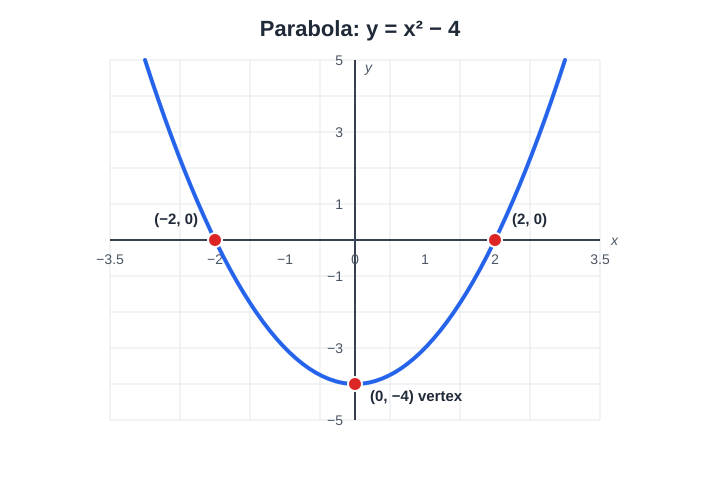
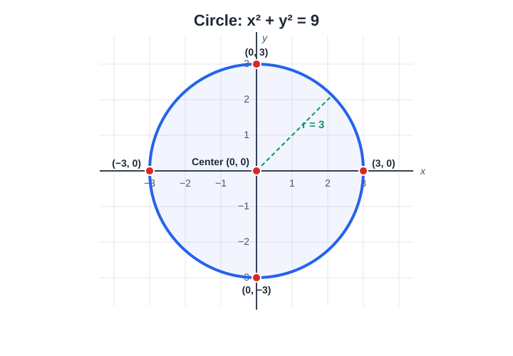

# Quadratic Equations – Explanation and Examples

A quadratic equation is a mathematical equation in which the highest power of the variable is 2.

The general form of a quadratic equation is:

$$
ax^2+bx+c=0
$$

where:

- $a$, $b$, and $c$ are real numbers.
- $a\neq 0$, because otherwise the equation would be linear.
- $x$ is the unknown variable.

For example:

$$
2x^2-5x+3=0
$$

Here, $a=2$, $b=-5$, and $c=3$.

## 1. The Quadratic Formula

Any quadratic equation can be solved using the quadratic formula:

$$
x=\frac{-b\pm\sqrt{b^2-4ac}}{2a}
$$

The expression under the square root is called the discriminant, denoted by $\Delta$:

$$
\Delta=b^2-4ac
$$

The discriminant tells us how many real solutions the equation has.

| Discriminant   | Number of real solutions |
| -------------- | ------------------------ |
| $\Delta>0$ | Two distinct solutions   |
| $\Delta=0$ | One repeated solution    |
| $\Delta<0$ | No real solutions        |

## 2. Example – Solving a Quadratic Equation

Solve:

$$
x^2-5x+6=0
$$

Step 1: Identify the coefficients.

$$
a=1,\quad b=-5,\quad c=6
$$

Step 2: Calculate the discriminant.

$$
\Delta=(-5)^2-4(1)(6)
$$

$$
\Delta=25-24=1
$$

Since $\Delta>0$, the equation has two distinct real solutions.

Step 3: Apply the quadratic formula.

$$
x_{1,2}=\frac{5\pm\sqrt{1}}{2}
$$

Therefore,

$$
x_1=\frac{5+1}{2}=3
$$

$$
x_2=\frac{5-1}{2}=2
$$

Final answer:

$$
\boxed{x_1=3,\qquad x_2=2}
$$

We can verify this by factorization:

$$
x^2-5x+6=(x-2)(x-3)=0
$$

## 3. Graph of a Quadratic Function

A quadratic function has the form:

$$
y=ax^2+bx+c
$$

Its graph is called a parabola.



*Figure: The graph of $y=x^2-4$. Its vertex is $(0,-4)$, and it crosses the x-axis at $x=-2$ and $x=2$.*

- If $a>0$, the parabola opens upward.
- If $a<0$, the parabola opens downward.
- The vertex is the maximum or minimum point of the parabola.
- The real solutions of the quadratic equation correspond to the points where the graph crosses or touches the x-axis.

## 4. Quadratic Equations in Two Variables – The Circle

While a standard quadratic function produces a parabola, a quadratic equation containing both $x^2$ and $y^2$ terms with equal coefficients describes a **circle**:

$$
(x - h)^2 + (y - k)^2 = r^2
$$

where:

- $(h, k)$ are the coordinates of the circle's center.
- $r$ is the radius ($r > 0$).

### Example: Circle Centered at the Origin

Consider the equation:

$$
x^2 + y^2 = 9
$$

Here:

- Center: $(h, k) = (0, 0)$
- Radius: $r = \sqrt{9} = 3$



*Figure: The graph of $x^2+y^2=9$. It is centered at $(0,0)$ with radius $r=3$, intersecting the coordinate axes at $(3, 0)$, $(-3, 0)$, $(0, 3)$, and $(0, -3)$.*

Key properties:
- **Center:** The origin $(0, 0)$.
- **Radius:** $r = 3$ units in all directions.
- **$x$-intercepts:** Set $y = 0 \implies x^2 = 9 \implies x = \pm 3 \implies (-3, 0)$ and $(3, 0)$.
- **$y$-intercepts:** Set $x = 0 \implies y^2 = 9 \implies y = \pm 3 \implies (0, -3)$ and $(0, 3)$.

## 5. Practice Exercises

Try solving these equations using the quadratic formula.

Exercise 1

$x^2-7x+10=0$

Show answer
Exercise 2

$x^2+6x+9=0$

Show answer

Exercise 3

$2x^2-8x+6=0$

Show answer

Key takeaway: A quadratic equation can have two, one, or no real solutions. The discriminant determines which case occurs, and the quadratic formula gives the solutions when they are real.


## Copilot

Copilot is an AI-powered code completion tool developed by GitHub. It assists developers by suggesting code snippets and entire functions based on the context of the code being written.

Example:

```python
# Example usage of GitHub Copilot
def quadratic_formula(a, b, c):
    discriminant = b**2 - 4*a*c
    if discriminant < 0:
        return None
    x1 = (-b + discriminant**0.5) / (2*a)
    x2 = (-b - discriminant**0.5) / (2*a)
    return x1, x2

# Solve the quadratic equation x^2 - 5x + 6 = 0
solutions = quadratic_formula(1, -5, 6)
print(solutions)
```

## Note about circle

A circle is defined by its center and radius. The general equation of a circle is:	

$$
(x - h)^2 + (y - k)^2 = r^2
$$

where:

- $(h, k)$ are the coordinates of the circle's center.
- $r$ is the radius ($r > 0$).

Example:

Consider a circle centered at the origin with radius 3:

$$
x^2 + y^2 = 4^2
$$

Key properties:
- **Center:** The origin $(0, 0)$.
- **Radius:** $r = 4$ units in all directions.
- **$x$-intercepts:** Set $y = 0 \implies x^2 = 16 \implies x = \pm 4 \implies (-4, 0)$ and $(4, 0)$.
- **$y$-intercepts:** Set $x = 0 \implies y^2 = 16 \implies y = \pm 4 \implies (0, -4)$ and $(0, 4)$.
- **Diameter:** $d = 2r = 8$ units.
- **Circumference:** $C = 2\pi r = 8\pi$ units.
  